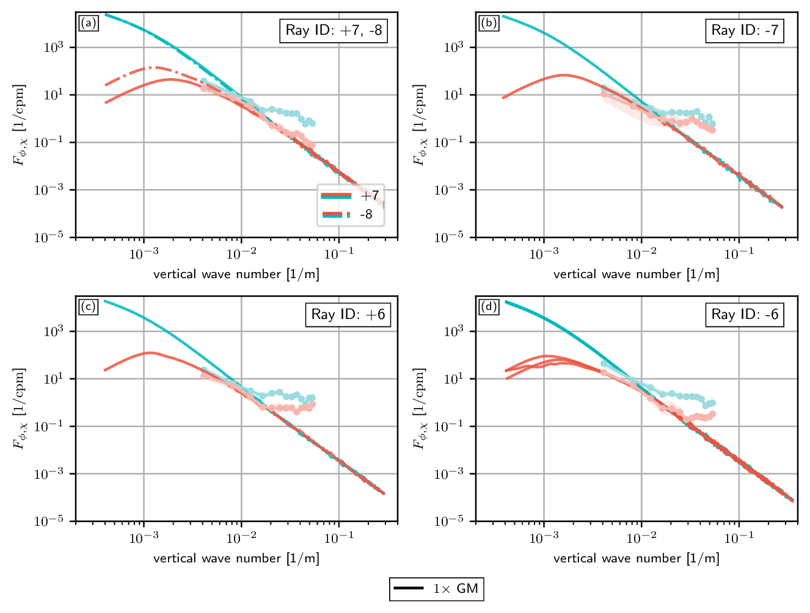

# n23_fluctuations_ragland

[![Actions Status][actions-badge]][actions-link]
[](https://github.com/astral-sh/ruff)

<!-- SPHINX-START -->

<!-- prettier-ignore-start -->
[actions-badge]:            https://github.com/John-Ragland/n23_fluctuations_ragland/workflows/CI/badge.svg
[actions-link]:             https://github.com/John-Ragland/n23_fluctuations_ragland/actions

<!-- prettier-ignore-end -->

<p align="center">
  
</p>

This package contains the code supporting the data analysis of the NESCAFE
2023 Experiment. The NESCAFE
2023 experiment consisted of acoustic transmissions across the Gulf Stream
front. An analysis of the fluctuations of acoustic intensity, phase, and the
coherence of the acoustic receptions is described in the paper _Analysis of
acoustic fluctuations for 150-km, low frequency transmissions across the Gulf
Stream in the vicinity of the New England Seamount chain_ (Ragland et al.,
2026; submitted to the Journal of the Acoustical Society of America), available
as a preprint at
[doi:10.22541/essoar.15006016/v1](https://doi.org/10.22541/essoar.15006016/v1).
See [Citation](#citation) for how to cite it.

This package contains the code used for the data analysis that is presented in
this paper, as well as generating the figures for publication.

## Installation / Setup

This package is a git submodule of the
[NESCAFE23](https://github.com/John-Ragland/NESCAFE23) workspace and is
installed from there, because it depends on the workspace's base library
`nescafe23`, which `uv` resolves from the workspace. Install
[uv](https://docs.astral.sh/uv/) first. Then clone the workspace, check out
this submodule, and sync:

```bash
git clone https://github.com/John-Ragland/NESCAFE23.git
cd NESCAFE23
git submodule update --init projects/n23_fluctuations_ragland
uv sync --package n23_fluctuations_ragland --all-groups
```

Some of the workspace's other submodules are not public yet (see
[Released components](https://github.com/John-Ragland/NESCAFE23#released-components)
in the NESCAFE23 README), so don't clone
with `--recurse-submodules`: git would fail (or ask for GitHub credentials) on
the private ones. Their folders stay empty, which `uv` ignores. Because they are
missing, `uv sync` updates `uv.lock` to drop them; this is expected, and
`--locked` will fail.

This creates one virtual environment (`.venv` at the workspace root) with
`nescafe23` and this package installed in editable mode, plus the test, dev
and docs dependency groups. The workspace pins Python 3.13
(`.python-version`), and `uv` downloads it if needed. The dependencies that are
not on PyPI ([pygenray](https://github.com/John-Ragland/pygenray) and
[cmps](https://github.com/John-Ragland/cmps)) are installed from GitHub
automatically.

Run the commands with `uv run` from anywhere in the workspace (e.g.
`uv run n23_fluctuation_analysis`), or activate the environment with
`source .venv/bin/activate`. Check the installation with

```bash
uv run pytest projects/n23_fluctuations_ragland/tests
```

Each submodule is its own git repository, so commit changes to this package
from within `projects/n23_fluctuations_ragland/`.

**Development.** Notebook outputs are stripped by `nbstripout` to keep the repo
small, and ruff runs as a pre-commit hook. To enable both, run within `projects/n23_fluctuations_ragland/`:

```bash
uv run nbstripout --install
uv run pre-commit install
```

**Data.** The raw data, intermediate data products, and final results are kept
in one directory with a fixed structure. Its location is set by
`NESCAFE23_DATADIR` in a `.env` file at the workspace root (see `.env.example`):

```bash
NESCAFE23_DATADIR="/path/to/data/directory/"
```

You don't have to write it by hand: on start, `uv run n23_fluctuation_analysis`
asks for the directory if it is not set, saves it to the `.env`, and lists any
missing inputs (below). From there you can continue to the menu anyway, change
the directory, or create the expected folder layout (`dmod/`,
`environment_data/`, `dataproducts/`). The menu's "set data directory" entry
changes it later. Saving the path rewrites only `NESCAFE23_DATADIR`; other
variables in the `.env` are kept. To access the experiment data, please reach
out to me (John Ragland) directly.

## Reproducing the paper

Everything in the paper that comes from this package (Figs. 1, 2, 5–11 and
Table II) is made by one command:

```bash
n23_fluctuation_analysis --reproduce-paper --output paper_output
```

or interactively, with the first menu entry of `n23_fluctuation_analysis`
("reproduce paper"). It checks first that every input is present, then runs
the processing steps in order, writes Table II, builds every figure, and stops
at the first failure. Add `--reuse` to reuse data products that already exist
instead of recomputing them. Figs. 3, 4 and 12 (the moored internal-wave
observations) are not made by this package.

Outputs:

- `$NESCAFE23_DATADIR/dataproducts/`: the intermediate data products (arrival
  time offsets and their jackknife errors, mean pulse, peak picks, array tilt,
  hydrophone pattern, wavefront values, ray traces)
- `paper_output/table_II.tex`: Table II
- `paper_output/figures/`: the figures, named as in the manuscript
- `paper_output/reproduction_report.txt`: package version and commit, the
  analysis settings (`tools.PAPER_SETTINGS`), the time of each step, and the
  numbers the paper quotes from the data products

**Inputs.** `NESCAFE23_DATADIR` (in the `.env` of the workspace root) must
contain:

| Path                                       | Contents                                   |
| ------------------------------------------ | ------------------------------------------ |
| `dmod/dm*.mat`                             | the 23 demodulated receptions (on request) |
| `environment_data/FCTD_SoundSpeed_Colosi_v2.mat` | FCTD section                         |
| `environment_data/SION_CTD_new.mat`, `SIOE_CTD.mat` | mooring CTD casts                 |
| `environment_data/map_bathy.nc`            | GEBCO bathymetry for the map               |
| `environment_data/cmems_obs-sl_glo_phy-ssh_my_allsat-l4-duacs-0.125deg_P1D_1773078040918.nc` | CMEMS sea surface height |
| `fonts/RedHatDisplay-Medium.ttf`           | map font (optional)                        |

The demodulated receptions are not public. They are available from the
corresponding author on reasonable request. Without LaTeX on the `PATH`, the
figures are built with `usetex: false`.

**Individual steps.** The other menu entries run one step at a time, in
pipeline order: arrival time offset → its jackknife error → mean pulse → peak
locations → array tilt → wavefront values and hydrophone pattern → rays →
Table II → publication figures. To build the figures with other settings, use
"create publication figures config" and "generate publication figures". The
config's defaults are the paper's.

**Exploratory analysis.** Analysis that is not in the paper (the GM + noise fit
of the spectra, the GM levels table, the transmission independence test, the
estimation experiments, the theory environments, the source geometry sweep) is
not in the CLI. Its code is in `tools`, `estimation` and `theory_environments`,
and the one-off studies are in `analysis/`.

**Source Localization** The depth and range of the acoustic source is estimated
with a linear Gauss-Markov approach, based on (Munk et. al. 1995). This method
is in the process of being published separately, so the code for this is omitted
from the initial public release of this package. If this code is of interest to
you, please feel free to reach out to me (John Ragland) directly.

**Source Geometry Sweep** The exact source location is unknown, because the
mooring was lost. For this paper, the source geometry is chosen based on the
best match of rays through the FCTD and the lineup of the ducted arrivals and
first boundary reflected arrivals. `tools.source_geometry_sweep` performs a grid
search over a range of source depths and ranges, whose result
(`ray_geo_sweep.pkl`) the source geometry sweep panel app shows. It is not
required for the analysis, but shows the context in which the source geometry
was chosen.

## Figures

The publication figures are made by `src/n23_fluctuations_ragland/figures.py`
(see above). The notebooks in `notebooks/publication_figures` are the original
figure source and may drift from the current code.


## Citation

If you use this code, please cite the paper. The citation is in
[`CITATION.cff`](CITATION.cff), and GitHub's "Cite this repository" button
(in the repository sidebar) exports it as APA or BibTeX:

```bibtex
@article{Ragland_2026,
  title     = {Analysis of acoustic fluctuations for 150-km, low frequency
               transmissions across the Gulf Stream in the vicinity of the New
               England Seamount chain},
  author    = {Ragland, John and Colosi, John and Hoekstra, Katherine and
               Dzieciuch, Matthew and Alford, Matthew and Bellerjeau, Charlotte},
  year      = {2026},
  month     = jul,
  publisher = {ESS Open Archive},
  doi       = {10.22541/essoar.15006016/v1},
  url       = {https://doi.org/10.22541/essoar.15006016/v1},
  note      = {Preprint, submitted to the Journal of the Acoustical Society of America}
}
```

## References

Munk, W., Worcester, P., and Wunsch, C. (1995). Ocean Acoustic Tomography,
Cambridge University Press, 457 pages.
